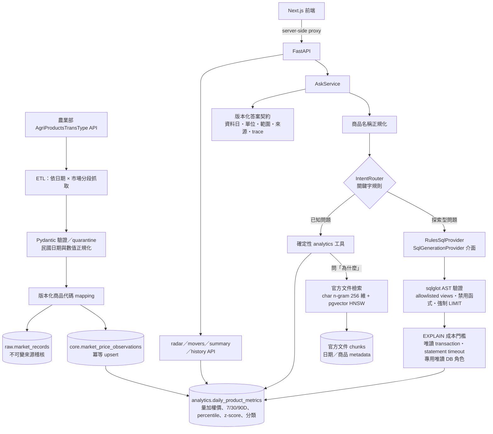

# Price Lens — AI 民生物價雷達

> 把台灣農業部的農產品批發行情，轉成「現在算貴嗎？」可追溯、可解釋的價格訊號，並用受控的 Text2SQL 與官方文件檢索回答自然語言問題。

**先說清楚：目前的 AI Search 是可重現的規則 baseline，尚未接 LLM。** 意圖判斷用關鍵字規則、Text2SQL 用規則模板產生 SQL、官方文件檢索用字元 n-gram hashing 向量；整個系統沒有呼叫 LLM、外部 embedding 或任何學習式模型。SQL 生成透過 provider 介面隔開，日後換成 LLM provider 時，SQL 驗證與唯讀執行限制維持不變。

## 要解決的問題

- **誰**：想知道高麗菜、番茄等民生農產品「現在是不是偏貴」的一般使用者，以及需要可信數字的內容或分析人員。
- **痛點**：官方行情是逐日、逐市場、以民國日期與官方品項代碼發布的原始交易資料；要回答「貴不貴」得自己做清理、跨市場加權與歷史比較。
- **為什麼難**：
  - 資料語意容易誤用：這是**批發市場行情（TWD/kg）**，不是超市零售價；休市不是零價；「今天」其實是最近一個有交易的日子。
  - 讓 AI 直接寫 SQL 或解釋漲價原因，很容易產生錯誤數字或捏造因果。
  - 因此本專案把「算數字」交給 SQL／Python，把「找背景」交給有引用的官方文件，並讓 AI 層只能走受控、可驗證的路徑。

## Demo

<!-- TODO: 截圖待補：以 `docker compose up --build -d db api frontend` 啟動，執行一次 ETL 與 analytics-refresh 後，擷取 http://localhost:3000 首頁（價格雷達＋每週漲跌）與 AI Search 回答「高麗菜現在算貴嗎？」的畫面，存到 docs/images/。本次整理時本機磁碟已滿、Docker daemon 無法建置映像，因此未能擷取。 -->

目前沒有公開部署的網址；請依[如何執行](#如何執行)在本機以 Docker Compose 啟動。啟動後：

| 入口 | 內容 |
|---|---|
| <http://localhost:3000> | Next.js 產品介面：市場雷達、每週漲跌、商品價量圖、AI Search |
| <http://localhost:8000/docs> | FastAPI OpenAPI 文件 |
| `POST /api/v1/ask` | `{"question":"高麗菜現在算貴嗎？"}`，回傳附資料日期、單位、範圍與來源的結構化答案 |

## 架構



- 模組化單體：`ingestion`、`db`、`analytics`、`api`、`ai`、`rag` 與前端各自分離（`backend/src/price_lens/`、`frontend/src/`）。
- PostgreSQL 分 `raw`、`core`、`analytics` 三個 schema；唯一鍵 `(source_id, trade_date, market_id, product_id)` 防止重複，價格與數量以 `numeric` 保存。
- 前端只透過 Next.js server 端（`frontend/src/app/api/ask/route.ts`）呼叫 API，瀏覽器不持有資料庫或後端 credential。

## 技術重點

**1. AI 只能走受控路徑：數字由程式算，AI 不算。**
`AskService`（`backend/src/price_lens/ai/service.py`）先正規化商品名稱，再由 `IntentRouter` 決定走 typed analytics 工具或 Text2SQL。已知問題（「現在算貴嗎」「排行」「漲跌」）交給確定性工具；只有探索型問題才產生 SQL。

**2. Text2SQL 的多層防線，與 SQL 產生器解耦。**
SQL 產生器是可替換的 `SqlGenerationProvider`（目前唯一實作是 `RulesSqlProvider`）。不論 SQL 從哪來，都要通過：

- `ai/text2sql/validator.py`：sqlglot 解析 AST，只允許 `analytics` 的 allowlisted views、禁用函式、強制 LIMIT；
- `ai/text2sql/executor.py`：先以 `EXPLAIN` 做成本門檻，再以唯讀 transaction、statement／lock timeout，透過專用唯讀登入角色（`db/provision_text2sql.py`）執行。

這讓「之後換成 LLM 產生 SQL」只需要新增一個 provider，安全邊界不必重做。

**3. RAG 只提供「可能背景」，不當成因果證明。**
`rag/documents.py` 只接受 `moa.gov.tw`、`agrstat.moa.gov.tw`、`afa.gov.tw` 的 HTTPS 頁面；匯入時由人工標記發布日期、事件期間與商品，正文以 SHA-256 去重。檢索只取「價格資料日以前發布、商品吻合、事件期間與近 60 日重疊」的文件；沒有符合的文件就明確 abstain。文件內容視為不可信資料，不當作指令。

**4. 資料語意與可追溯性。**

- 全市場價格採量加權：`sum(price × volume) / sum(volume)`；休市或缺資料不當作零價。
- 官方代碼與名稱原樣保存，消費者名稱（例如「高麗菜」→「甘藍」）放在獨立、版本化的 mapping（`ingestion/mappings/product_mappings.v1.json`）。
- 價格回答都附最新交易日、單位、市場範圍、商品 mapping 與來源；ETL 冪等，可安全重跑。

**5. 評估先行，不為微調而微調。**
每個 AI 元件都有凍結、版本化的評估集（`evals/datasets/`）與報告（`evals/reports/`）。因為 normalization／intent MVP 集目前沒有錯誤可針對，**刻意沒有做 LoRA**——沒有錯誤切片，就沒有可驗證的微調假設（見 `docs/phase-6-review.md`）。

## 成果與數字

| 項目 | 結果 | 來源 |
|---|---|---|
| 後端 unit tests | **72 passed**（2026-10-30 本機重跑，Python 3.13；不含需 PostgreSQL 的 integration 與 live contract tests） | `backend/tests/unit/` |
| 後端完整測試（含 integration） | 77 passed、1 skipped（官方 API live test），Ruff 通過 | `docs/phase-6-review.md` |
| 前端 | 11 個 Vitest cases、ESLint、TypeScript、Next.js production build 通過 | `docs/phase-6-review.md` |
| Phase 4 controlled AI 評估 | normalization 18/18、intent routing 14/14、Text2SQL validation／execution 10/10、adversarial SQL 阻擋 20/20 | `evals/reports/phase4-controlled-ai.v1.json` |
| Phase 5 官方文件檢索 | Recall@5、MRR、引用網域正確率、abstention accuracy 皆 1.0（3 題／9 份合成文件） | `evals/reports/phase5-rag.v1.json` |
| Phase 6 價格分類邊界 | 9/9 | `evals/reports/phase6-classification.v1.json` |
| Release smoke | API health／radar、前端首頁各 10 次請求 0 失敗；外部模型呼叫 0 次 | `evals/reports/phase6-release-smoke.v1.json` |
| 一年期官方資料 backfill（2026-09-28） | 69,158 筆正規化 observation、50 個來源品項、19 個市場、11 筆 quarantine、0 組重複 natural key；analytics 32,806 列，refresh 61.90 秒 | `docs/phase-4-review.md` |

以上評估集都是小型 MVP 集或合成 fixture，**不能外推為生產準確率或任意自然語言 SQL 的準確率**；所有數字描述的是官方批發市場資料，不是零售價。

## 如何執行

需求：Git、Docker Desktop（含 Docker Compose v2）。

```powershell
Copy-Item .env.example .env          # 本機開發用；請自行替換密碼，.env 已被 Git 忽略
docker compose up --build -d db api frontend
docker compose ps
```

Windows 也可執行 `./scripts/demo.ps1`，會啟動並等待 API 健康檢查。API 啟動時會自動執行 migration，並 provision Text2SQL 專用唯讀角色。

全新資料庫需要先匯入官方行情（呼叫公開 API，不需要 API key）：

```powershell
# 最近 7 個日曆日的增量同步
docker compose --profile tools run --rm etl etl --days 7
docker compose --profile tools run --rm etl analytics-refresh
docker compose --profile tools run --rm etl data-quality
```

一年期、只抓已 mapping 品項的 backfill（ingestion metadata 會標示這是受限範圍）：

```powershell
docker compose --profile tools run --rm etl etl `
  --start 2025-09-25 --end 2026-09-24 `
  --job-type mapped-backfill --mapped-products-only
docker compose --profile tools run --rm etl analytics-refresh
```

匯入一份官方背景文件（日期與商品範圍須由匯入者依原文確認）：

```powershell
docker compose run --rm api python -m price_lens.rag.cli ingest `
  https://www.afa.gov.tw/example `
  --published-at 2026-09-20 --event-start 2026-09-18 --event-end 2026-09-24 `
  --product cabbage
```

測試、lint 與評估：

```powershell
docker compose run --rm api pytest -m "not live"
docker compose run --rm api ruff check .
docker compose run --rm api python /app/evals/runners/phase5_rag_eval.py
make ci   # lint、test、Phase 4/5/6 評估與前端映像建置
```

不使用 Docker 時，後端 unit tests 可在 Python 3.12+ 虛擬環境執行：`pip install -e "backend[dev]"`，再於 `backend/` 執行 `pytest tests/unit`。前端使用 Node.js 24 與 pnpm 11：`pnpm install --frozen-lockfile`、`pnpm test`、`pnpm build`。停止服務用 `docker compose down`（不加 `-v` 以保留資料）。

## 已知限制與下一步

- **AI 層是規則 baseline**：沒有 LLM、沒有語意 embedding。`AI_PROVIDER` 設定已預留，但程式還沒有依它切換 provider；下一步是新增 LLM `SqlGenerationProvider`，沿用同一套驗證、唯讀執行與評估集。
- **評估集很小**：Phase 4／5／6 都是 MVP 集或合成 fixture，滿分不代表泛化能力。
- **RAG 文件庫預設是空的**：需人工匯入官方文件並標記 metadata；字元 n-gram 屬 lexical 檢索。
- **沒有附資料庫快照**：全新安裝要先跑 ETL，圖表才有資料。
- Playwright E2E 與負載測試仍是後續工作；release smoke 是手動觸發的本機報告，不是排程監控。
- 只涵蓋批發行情，無法判斷特定商店的零售價是否偏貴。

## 我負責的部分

本專案由我（[mina201199](https://github.com/mina201199)）獨立完成，從需求定義、資料來源評估、系統設計、後端與前端實作、評估設計、測試到文件，皆由我負責。

## 延伸文件

- [System Architecture](docs/architecture.md)：完整 schema、模組邊界與 API 契約
- [官方資料來源評估](docs/data-source-assessment.md)
- [Phase 6 Review](docs/phase-6-review.md)：CI、評估 gate 與已知風險

## 授權

程式碼與文件以 [MIT License](LICENSE) 授權。農業部「農產品交易行情」等官方資料不在 MIT 授權範圍內，依政府資料開放授權條款－第 1 版使用。資料來源：[政府資料開放平臺資料集 8066](https://data.gov.tw/dataset/8066)、[農業資料開放平臺資料集 037](https://data.moa.gov.tw/open_detail.aspx?id=037)、[AgriProductsTransType API](https://data.moa.gov.tw/api/v1/AgriProductsTransType/)。
