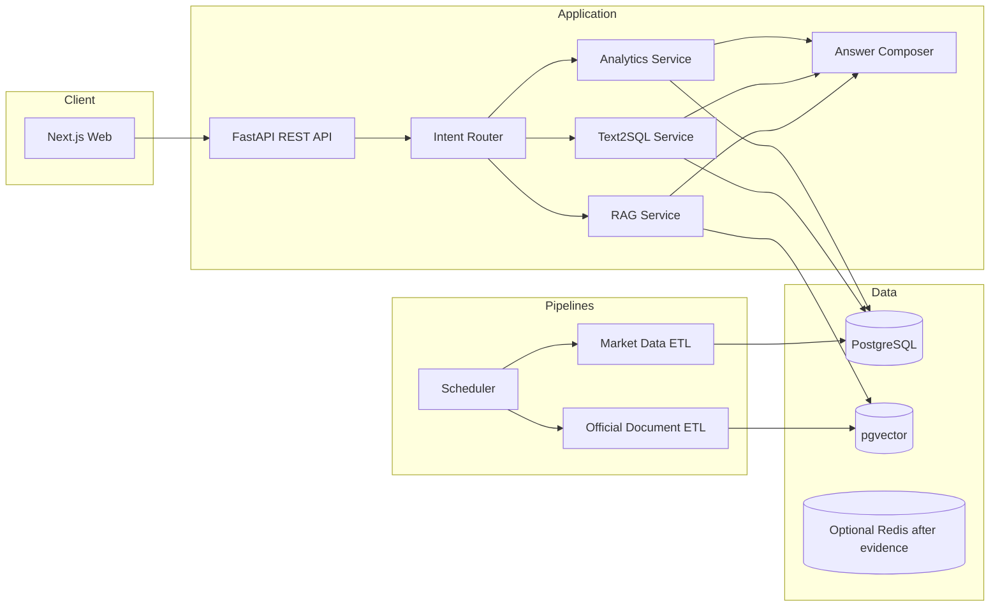
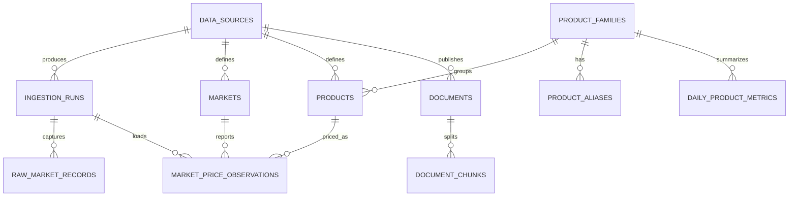

# Price Lens System Architecture

狀態：Phase 6 evaluation and release hardening implemented; see review limitations  
日期：2026-09-29

## 1. Architecture drivers

### 核心需求

- 將官方批發市場資料轉成可解釋、可測試的價格狀態。
- 支援固定產品功能與自然語言探索。
- 價格計算不得交給 LLM。
- 原因解釋不得由 LLM 猜測。
- 每個回答可追溯到 observation、計算版本與官方文件。
- 日更 ETL 可重跑、可補抓、可觀測。
- 在單機 Docker Compose 可完整 Demo，避免 MVP 過度分散式化。

### 非功能需求

- API p95（不含首次本地模型載入）目標：固定 analytics < 500 ms；Text2SQL + explanation < 8 s；RAG + explanation < 10 s。
- 所有 ingestion 與 analytics operation idempotent。
- Text2SQL 只能讀取 allowlisted semantic views。
- 當 LLM、RAG 或 embedding provider 不可用時，dashboard 與 deterministic analytics 仍可使用。

## 2. 關鍵設計修正

### 2.1 Next.js 優先於 Streamlit

作品集的核心不只是模型，而是完整 AI application engineering。Next.js 能展示 responsive UI、loading/error states、typed API client、產品資訊層級與部署能力。Streamlit 開發快，但視覺與 application architecture 容易像資料 demo；因此只保留為未來 internal QA 工具的可能性。

### 2.2 不讓所有查詢走 Text2SQL

已知產品問題（目前是否偏高、近一月漲幅、排行、歷史低點）使用 typed analytics tools。這些 query 可版本控制、測試與快取。Text2SQL 只負責未覆蓋的 read-only exploratory questions。這既展示 Text2SQL，也不犧牲主產品可靠性。

### 2.3 Router，不做 autonomous agent

Router 輸出結構化 intent 與 tool arguments；服務端再驗證並執行。初版 intent：

- `price_status`
- `price_trend`
- `price_ranking`
- `historical_extreme`
- `reason_lookup`
- `meal_value_suggestion`
- `exploratory_sql`
- `general_help`

需要價格加原因時可以組合 analytics + RAG，但工具調用上限固定，不允許無界迴圈。

### 2.4 LoRA 設為 evidence-based gate

商品 normalization 先使用 source code、alias table、fuzzy match 與 structured LLM baseline。只有當代表性測試集顯示本地 base model 明顯不足，且錯誤可由 supervised examples 改善，才做 LoRA。若 alias/rules 已達目標，LoRA 不進產品路徑。

## 3. Container-level architecture



MVP 不引入微服務、Kafka、Airflow 或 Kubernetes。Web、API、worker 與 PostgreSQL 可是不同 container，但仍屬單一 modular monolith repository。排程初版使用一個可手動執行的 job 加 cron-compatible entrypoint；若部署平台提供 scheduler，直接觸發同一 command。

## 4. Request flows

### 4.1 固定價格問題

```text
question
→ normalize product / market / time range
→ router selects typed analytics tool
→ SQL/Python computes metrics
→ classifier applies versioned rules
→ answer composer verbalizes structured result
→ response includes as_of, scope, unit, method and source
```

LLM verbalization失敗時，API 以 template fallback 回傳同一組 metrics。

### 4.2 長尾 Text2SQL

```text
question
→ schema context limited to semantic views
→ LLM proposes one SELECT
→ parse AST
→ reject forbidden nodes/functions/tables and multiple statements
→ inject/cap LIMIT
→ EXPLAIN with timeout
→ execute through text2sql_readonly role
→ shape/row-count validation
→ result verbalization
```

Defense in depth：

1. Prompt 只提供 allowlisted views 與 business definitions。
2. 使用 SQL parser（預計 `sqlglot`）做 AST allowlist；不以 regex 作唯一防線。
3. 僅允許單一 `SELECT`/CTE；拒絕 DDL、DML、COPY、CALL、DO、transaction control、system catalogs 與 dangerous functions。
4. DB role 只有 analytics schema 的 `SELECT` 權限，沒有 base tables、temporary table 或 function execution 權限。
5. `default_transaction_read_only=on`、`statement_timeout`、`lock_timeout`、row limit 與連線池隔離。
6. 執行前 `EXPLAIN`，阻擋無時間條件的大表掃描與過高 cost。
7. 紀錄 question、generated SQL、validation result、latency 與 row count；不紀錄 secrets。

### 4.3 原因問題

```text
question
→ analytics proves whether/when/how much price changed
→ retrieval filters official allowlist + product + publication/event dates
→ rerank
→ answer separates observed price facts from documented possible factors
→ each reason sentence carries citation
```

沒有足夠文件時回答「資料顯示價格有變化，但目前沒有找到時間與品項相符的官方原因說明」。

## 5. Price analytics specification v0

### 5.1 Daily canonical series

每個 observation 是日期 × 市場 × source product。canonical family 的 daily price 為交易量加權平均：

```text
P(d) = Σ(avg_price(d,m,p) × volume(d,m,p)) / Σvolume(d,m,p)
```

只有 product mapping 明確納入的 `p` 才參與。API 回傳名稱相似不等於同一商品。結果保存 included market count、product codes 與 total volume，以便解釋 scope。

### 5.2 Metrics

- `ma_7d`, `ma_30d`, `ma_90d`：最近 7/30/90 個日曆日中的可用交易日平均，UI 明確標示算法。
- `wow_change_pct`：最近可用價相對 7 日前最近可比交易日。
- `mom_change_pct`：最近可用價相對 30 日前最近可比交易日。
- `percentile_365d`：最近 365 日 daily canonical series 的 percentile rank。
- `z_score_365d`：保留需求指定的標準 z-score。
- `robust_z_365d`：以 median/MAD 輔助 outlier classification。
- `historical_high/low`：指定 window 內的值與日期。
- `volume_change_pct`：最近 7 日總量對前 7 日總量。
- `volatility_30d`：daily log return 的 30 日標準差；資料不足則 null。

Phase 2 鎖定的細節：percentile 使用 midpoint empirical rank `(less + 0.5 × equal) / n`，避免 constant series 被標成 100；WoW/MoM 取目標日當天或之前最近交易日，但若比目標日再早超過 7 天則回傳 null；high/low 使用最近 365 個日曆日並在同價時保留最早日期；volatility 使用 population standard deviation，至少需要 2 個 log returns。

### 5.3 Classification v0

分類是可版本化規則，不是 LLM opinion。初版候選規則：

1. 歷史有效日少於 120 天：`insufficient_data`。
2. `percentile >= 95` 且 `robust_z >= 2`：`anomalously_high`（🔴 異常高）。
3. `percentile >= 75` 或 `current / ma_30d >= 1.15`：`high`（🟠 偏高）。
4. `percentile <= 25` 或 `current / ma_30d <= 0.85`：`low`（🟢 偏低）。
5. 其他：`normal`（⚪ 正常）。

衝突以異常高 → 偏高 → 偏低 → 正常的順序處理，並在 Phase 2 用 fixtures 與歷史事件回測後再鎖定閾值。季節性強的商品可能需要「同月份歷史 percentile」；先量測誤判再增加，不在 v0 假裝已解決。

## 6. PostgreSQL schema

Schema 分為 `core`、`raw`、`analytics`、`rag`。所有時間戳使用 `timestamptz`，價格用 `numeric`，日期用 Gregorian `date`。

### 6.1 Provenance and ingestion

#### `core.data_sources`

| column | type | notes |
|---|---|---|
| `id` | bigint PK | |
| `code` | text unique | 例如 `moa_farm_trans_v1` |
| `name` | text | 官方資料集名稱 |
| `publisher` | text | 農業部／農糧署 |
| `dataset_url` | text | metadata page |
| `api_url` | text | endpoint |
| `license_name` | text | 政府資料開放授權條款第 1 版 |
| `active` | boolean | |
| `created_at`, `updated_at` | timestamptz | |

#### `core.ingestion_runs`

`id`, `source_id`, `job_type`, `window_start`, `window_end`, `request_params jsonb`, `status`, `records_received`, `records_inserted`, `records_updated`, `records_unchanged`, `records_excluded`, `records_quarantined`, `started_at`, `finished_at`, `error_summary`, `code_version`。`unchanged` 與 `excluded` 是依真實 ETL 稽核需求加入，讓重跑與休市處理可被量測。

#### `raw.market_records`

`id`, `ingestion_run_id`, `source_id`, `source_record_hash`, `payload jsonb`, `fetched_at`, `validation_status`, `validation_errors jsonb`。以 hash 去重；保留有限 retention，不能成為 analytics query surface。

### 6.2 Dimensions

#### `core.markets`

`id`, `source_id`, `source_market_code`, `source_market_name`, `canonical_name`, `active`, `first_seen_at`, `last_seen_at`；unique `(source_id, source_market_code)`。

#### `core.product_families`

消費者層級商品，例如「甘藍（高麗菜）」、「番茄」、「香蕉」。欄位：`id`, `canonical_name`, `display_name`, `category`, `default_include_imported`, `active`, timestamps。

#### `core.products`

來源品項層級。欄位：`id`, `source_id`, `family_id nullable`, `source_product_code`, `source_product_name`, `category_code`, `variety`, `origin_type` (`domestic/imported/unknown`), `analytics_included`, `mapping_version`, `first_seen_at`, `last_seen_at`；unique `(source_id, source_product_code)`。

#### `core.product_aliases`

`id`, `family_id`, `alias`, `normalized_alias`, `locale`, `source` (`manual/official/evaluated_model`), `priority`, `active`。`高麗菜 → 甘藍` 由此處理，不能覆寫官方 source name。

### 6.3 Facts

#### `core.market_price_observations`

| column | type | notes |
|---|---|---|
| `id` | bigint PK | |
| `source_id` | FK | provenance |
| `ingestion_run_id` | FK | latest producing run |
| `trade_date` | date | ISO date |
| `market_id` | FK | |
| `product_id` | FK | source product |
| `upper_price` | numeric(12,2) | TWD/kg |
| `middle_price` | numeric(12,2) | TWD/kg |
| `lower_price` | numeric(12,2) | TWD/kg |
| `average_price` | numeric(12,2) | TWD/kg |
| `volume_kg` | numeric(16,2) | kg |
| `source_record_hash` | text | change detection |
| `fetched_at` | timestamptz | |

Unique `(source_id, trade_date, market_id, product_id)`。Index `(product_id, trade_date desc)`、`(market_id, trade_date desc)` 與 BRIN on `trade_date`（資料量值得時再加）。

休市資料不放入 fact table；若需要呈現市場狀態，可在後續新增 `core.market_calendar_events`，不以零價替代。

### 6.4 Analytics

#### `analytics.daily_product_metrics`

可重建的派生表：`trade_date`, `family_id`, `scope_key`, `weighted_avg_price`, `total_volume_kg`, `market_count`, `product_count`, `ma_7d`, `ma_30d`, `ma_90d`, `wow_change_pct`, `mom_change_pct`, `percentile_365d`, `z_score_365d`, `robust_z_365d`, `volatility_30d`, `classification`, `classification_version`, `computed_at`。

Unique `(trade_date, family_id, scope_key, classification_version)`。`scope_key` 初版支援 `all_reporting_markets` 與單一 market；若未來需要地區 scope，再正規化成 scope dimension。

#### Text2SQL semantic views

- `analytics.v_product_daily`
- `analytics.v_latest_product_status`
- `analytics.v_weekly_movers`
- `analytics.v_market_product_daily`

View 欄位採清楚英文名稱與 COMMENT，隱藏 raw JSON、internal IDs 與 ingestion implementation。Text2SQL role 只看這些 views。

### 6.5 RAG

#### `rag.documents`

`id`, `source_id`, `publisher`, `title`, `source_url`, `canonical_url`, `published_at`, `retrieved_at`, `content_hash`, `document_type`, `language`, `raw_text`, `metadata jsonb`, `active`。

#### `rag.document_chunks`

`id`, `document_id`, `chunk_index`, `content`, `token_count`, `embedding vector(N)`, `product_tags text[]`, `event_start`, `event_end`, `metadata jsonb`；unique `(document_id, chunk_index)`。Embedding dimension 在選定 model 後由 migration 固定，不先猜。

### 6.6 ER overview



## 7. API surface v0

```text
GET  /api/v1/health
GET  /api/v1/data-status
GET  /api/v1/products
GET  /api/v1/radar
GET  /api/v1/movers?direction=up|down&period=7d
GET  /api/v1/products/{slug}/summary
GET  /api/v1/products/{slug}/history?range=1y&market=all
POST /api/v1/ask
```

`POST /ask` 回傳統一 answer contract：

```json
{
  "answer": "...",
  "intent": "price_status",
  "as_of": "2026-09-26",
  "scope": {"type": "all_reporting_markets", "market_count": 17},
  "unit": "TWD/kg wholesale",
  "product": {"canonical_name": "甘藍", "matched_from": "高麗菜"},
  "metrics": {},
  "classification": {"label": "high", "rule_version": "v0"},
  "evidence": [],
  "official_context": [],
  "warnings": []
}
```

數值僅為 schema 示意，實際 market count 與日期由資料決定。

## 8. Repository structure

```text
price-lens/
├─ README.md
├─ .env.example
├─ .gitignore
├─ compose.yaml
├─ Makefile
├─ docs/
│  ├─ architecture.md
│  ├─ data-source-assessment.md
│  ├─ decisions/
│  └─ demo-script.md
├─ backend/
│  ├─ pyproject.toml
│  ├─ alembic.ini
│  ├─ migrations/
│  ├─ src/price_lens/
│  │  ├─ api/
│  │  ├─ core/
│  │  ├─ db/
│  │  ├─ ingestion/
│  │  │  ├─ sources/
│  │  │  ├─ validation/
│  │  │  └─ jobs/
│  │  ├─ analytics/
│  │  ├─ ai/
│  │  │  ├─ router/
│  │  │  ├─ text2sql/
│  │  │  ├─ rag/
│  │  │  └─ providers/
│  │  └─ schemas/
│  └─ tests/
│     ├─ unit/
│     ├─ integration/
│     ├─ contract/
│     └─ evaluation/
├─ frontend/
│  ├─ package.json
│  ├─ src/app/
│  ├─ src/components/
│  ├─ src/features/
│  ├─ src/lib/
│  └─ tests/
├─ evals/
│  ├─ datasets/
│  ├─ runners/
│  └─ reports/
├─ scripts/
└─ data/
   └─ samples/        # small, licensed, non-secret fixtures only
```

## 9. Phase plan and gates

### Phase 0 — Discovery and architecture（完成）

交付：需求邊界、官方 API 可行性、system architecture、schema、repository layout、Phase 計畫、風險、README、AGENTS.md。

完成條件：

- 官方欄位與新版 endpoint 經實際驗證。
- 批發／零售語意與 canonical product 問題有明確決策。
- Architecture 經使用者確認；未確認前不進 Phase 1。

測試／驗證：官方 API bounded smoke query、OpenAPI schema inspection、文件 link check、requirements traceability review。

### Phase 1 — Data foundation and reproducible ETL

狀態：完成並已通過 review gate；實際差異與測試結果見 `docs/phase-1-review.md`。

交付：Python project、PostgreSQL、Alembic、Docker Compose、source adapter、validation、24 個月 backfill command、7 日 incremental sync、seeded product mapping、data-status command/API。

完成條件：

- `docker compose up` 可啟動 DB 與 API。
- 同一 window 執行兩次不產生重複 observation。
- ingestion run 可看到 received/inserted/updated/quarantined。
- MVP 產品有 code-based mapping；未知品項不自動誤歸類。
- README 有可複製的 setup 與 commands。

測試：API contract tests、ROC date conversion unit tests、Pydantic validation、idempotency integration test、pagination test、duplicate/upsert test、休市與 malformed fixture tests、30 日 completeness report。

### Phase 2 — Analytics engine and typed backend API

狀態：已實作並完成一年期官方 mapped-product backfill、PostgreSQL analytics refresh、typed API 與 latency baseline，等待 review gate；結果見 `docs/phase-2-review.md`。

交付：daily canonical series、7/30/90D、WoW/MoM、percentile、z-score、high/low、volume、volatility、classification v0、radar/movers/detail APIs。

完成條件：

- 所有 metric 有明確 business definition 與 golden fixtures。
- 全市場價使用 volume weighting。
- 資料不足、休市、分母為零、單一市場與極端值均安全處理。
- 回應包含 `as_of/scope/unit/classification_version`。

測試：SQL/Python parity tests、hand-calculated golden dataset、property tests（例如 weighted price 落在 min/max 之間）、classification boundary tests、API integration tests、query latency baseline。

### Phase 3 — Product frontend

狀態：已實作並完成 production build、component tests、桌面／手機 Playwright critical path 與實資料視覺驗證；結果見 `docs/phase-3-review.md`。

交付：Next.js 首頁、今日價格雷達、漲跌榜、AI Search shell、商品頁、price/volume chart、freshness/error/empty states、responsive layout。

完成條件：

- 面試官不需要聊天也能理解產品價值。
- 每個價格都標示批發、單位、最新日期與 scope。
- 商品詳情可從 radar/movers 導航；圖表與 API 數字一致。
- API 暫時不可用時呈現可理解錯誤，不顯示假資料。

測試：component tests、API mocking、Playwright critical paths、mobile/desktop visual check、accessibility smoke test。

### Phase 4 — Controlled AI, tools and safe Text2SQL

交付：provider abstraction、product/entity normalization、intent router、typed analytics tools、safe Text2SQL、answer contract、template fallback、trace logging。

完成條件：

- 常見產品問題優先使用 deterministic tools。
- 任何非 SELECT、非 allowlisted view、多 statement 或超限 query 都被拒絕。
- Text2SQL DB role 實際無寫入權限，不能只靠程式判斷。
- LLM 關閉時固定 dashboard 與 analytics API 仍可運作。

測試：intent test set、product normalization set、malicious prompt/SQL suite、execution accuracy、result equivalence、timeout/cost/row-limit integration tests、fallback test。

Phase 4 target：代表性 Text2SQL dataset execution accuracy ≥ 85%，所有 destructive/adversarial cases 阻擋率 100%。門檻可在建立 dataset 後調整並留下理由。

### Phase 5 — Official-document RAG and grounded explanations

交付：official-domain allowlist、document ingestion、chunking/embedding、pgvector migration、metadata filters、retrieval/rerank、citation UI、價格事實與可能原因的分段回答。

完成條件：

- 每個原因 claim 有官方 citation，無證據時明確 abstain。
- retrieval 以 product/time/publisher metadata 限縮。
- 文件可依 content hash 更新，不重複 chunk。
- UI 可開啟原始官方頁面並顯示發布日期。

測試：人工標註 query-document set 的 Recall@k/MRR、citation correctness、faithfulness rubric、時間錯配負例、無文件 abstention test、broken source handling。

實作說明：`rag.documents` 只接受官方 allowlist 的 HTTPS HTML，匯入時明確提供發布日、事件區間和 canonical product slugs。正文依句子切 chunk，以固定字元 n-gram 向量寫入 pgvector；檢索先以 product、published_at、event window filter，再用 cosine distance 排序。這是可重現的 lexical embedding baseline，不宣稱具備語意模型能力。答案引用逐條指向原始文件並標出發布與事件日期；模板明示背景不等於已證實的價格因果。外部文件只作資料，不作指令。

### Phase 6 — Evaluation, hardening and portfolio release

交付：整合 evaluation report、latency/cost report、classification review set、CI、structured logging、freshness monitoring、security review、demo seed/snapshot、architecture decisions、demo script。

完成條件：

- 一條指令可啟動可 Demo 系統；一條指令可執行核心 test/eval。
- README 在 5 分鐘內說清楚問題、架構、資料、AI safety 與 results。
- 所有 KPI 記錄 model/version/dataset commit，結果可重現。
- 已知限制明列，不以 prototype 數字包裝 production claim。

測試：full E2E、fresh install test、dependency/security scan、load smoke test、backup/restore smoke test、evaluation regression gate。

LoRA 只作 Phase 6 之後的獨立 experiment：先凍結 normalization/intent dataset，比較 base vs LoRA 的 accuracy、macro-F1、invalid structured output rate、latency 與硬體成本。若沒有實質提升，不合併到 production path。

## 10. Evaluation design

| 能力 | 主要指標 | 必要切片 |
|---|---|---|
| Product normalization | exact canonical accuracy, top-k | 別名、品種、錯字、進口別、模糊詞 |
| Intent router | macro-F1, tool selection accuracy | single-tool、multi-tool、out-of-scope |
| Text2SQL | execution accuracy, result equivalence, unsafe rejection | ranking、time window、market filter、joins、adversarial |
| Retrieval | Recall@k, MRR, nDCG | product、event date、publisher、no-answer |
| RAG answer | citation correctness, faithfulness, abstention | supporting、conflicting、stale evidence |
| Classification | rule fixture accuracy + expert-reviewed agreement | stable、seasonal、spike、low volume、missing data |
| System | p50/p95 latency, error rate, freshness lag | cold/warm model、tool type |

Evaluation datasets 放在 repo，包含 provenance 與 expected result generation method；不可只展示挑選過的成功問題。

## 11. Risks and mitigations

### Product risks

- **批發價不是零售價**：以固定 UI disclaimer、單位與 answer contract 管理；不宣稱使用者實付價。
- **「便宜」依情境不同**：MVP 定義為相對該 canonical product 自身歷史批發價，不做跨商品營養／份量價值判斷。
- **火鍋推薦可能超出資料**：只從有資料且已定義為火鍋食材的 allowlist 比較 price status；不讓 LLM 自創商品或價格。

### Data risks

- 名稱／代碼、品種、進口別混雜：dimension mapping 版本化並人工審核。
- source 遲到、補正、休市與缺漏：rolling re-fetch、upsert、freshness 狀態、completeness metrics。
- outlier 影響統計：不任意刪除，保留 raw、quarantine、robust z-score 與 volume context。
- 市場組成每日改變：回應 market_count；Phase 6 評估 fixed-market panel 敏感度。

### AI/security risks

- Text2SQL prompt injection：AST allowlist + DB read-only role + views + resource limits。
- RAG prompt injection：官方 allowlist、文件內容視為 untrusted evidence，不接受其中的指令。
- Hallucinated causes：原因 claim 必須有 citation；價格與原因分開呈現。
- Provider lock-in：provider interface，但不先建立過度抽象的 multi-provider framework。
- Local LLM hardware variability：先建立 deterministic fallback 與可替換 provider，再做實測選型。

### Delivery risks

- 同時做 ETL、AI、RAG、前端容易失焦：每 Phase 都有可執行 vertical increment，未過 gate 不擴 scope。
- pgvector、Redis、queue 過早導入：pgvector 延至 RAG，Redis 只有 performance evidence 後才加入，queue 不列入 MVP。

## 12. Open architecture decisions for approval

建議本輪確認以下預設：

1. 對外 UI 使用 Next.js；Streamlit 不作主產品。
2. 預設價格是所有回報市場的 volume-weighted wholesale price，並允許商品頁切換市場。
3. 「高麗菜」預設只納入人工審核的國產甘藍主力品項；進口與特殊品種分開，不用名稱 substring 自動合併。
4. 先做 24 個月 backfill；UI 主要 percentile 使用 trailing 365 days。
5. MVP 到 Phase 5 功能完成，Phase 6 負責可重現 evaluation 與 portfolio hardening；LoRA 為其後有條件實驗。
